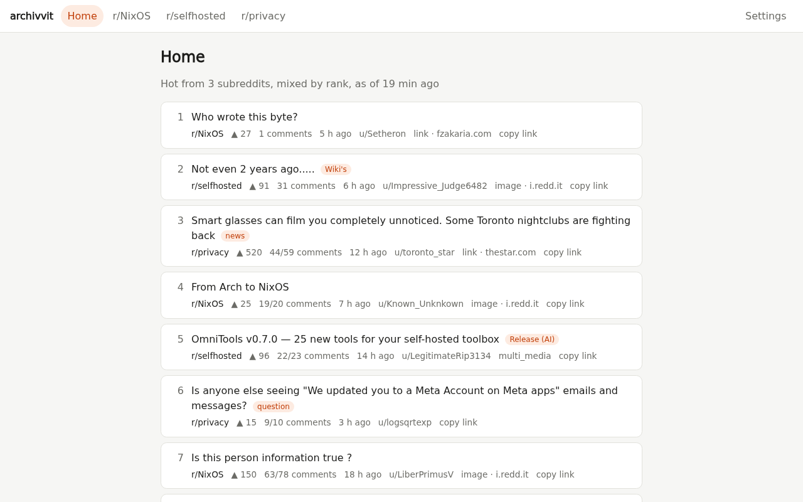
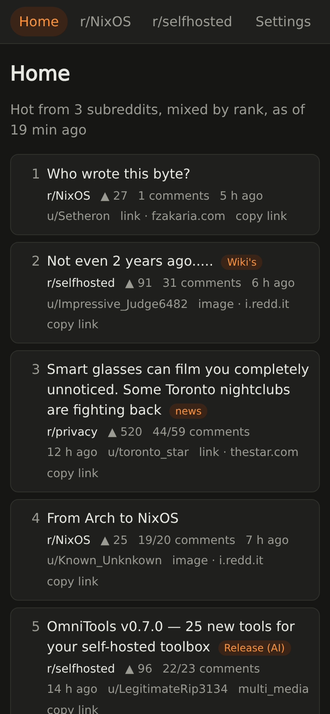
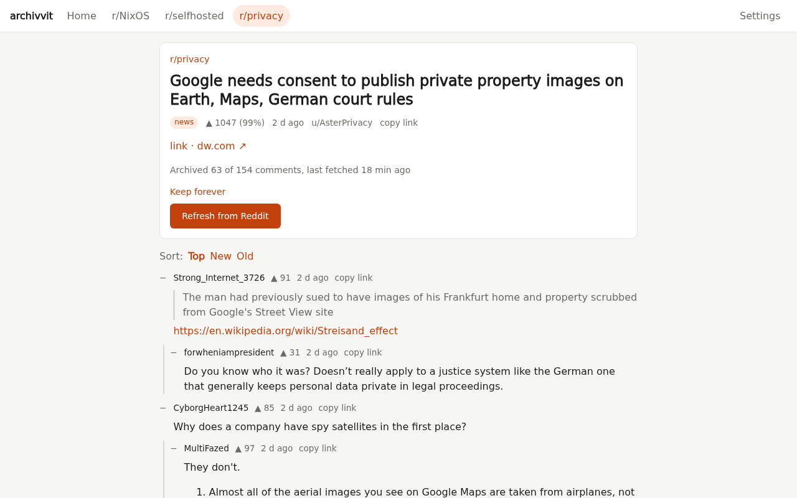
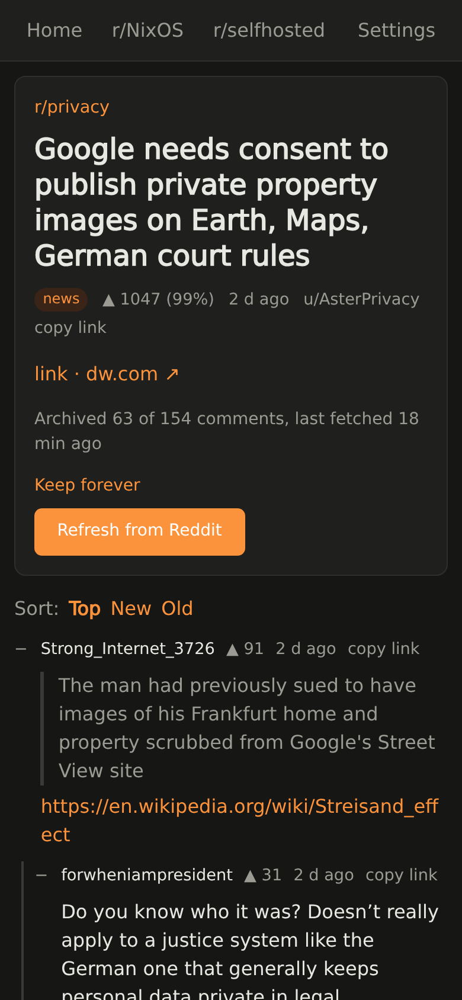
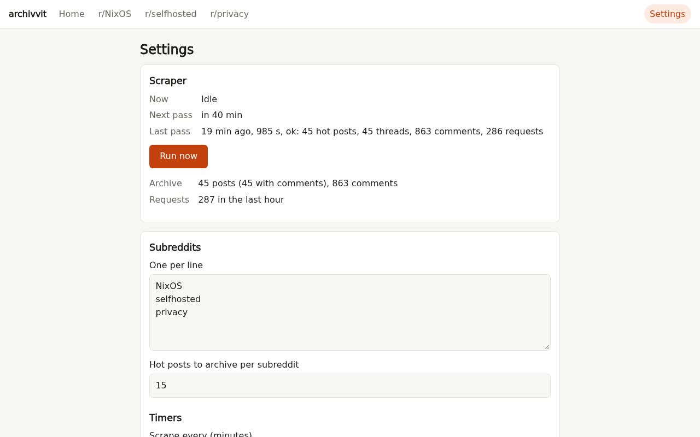

# archivvit

Read your subreddits without Reddit: a self-hosted, logged-out archive with a clean web UI.

If you used redlib or libreddit until Reddit blocked them, this is a different way to get the
same thing. archivvit doesn't proxy Reddit page by page as you browse. It visits the subreddits
you follow on a schedule, the way a logged-out browser would, saves the hot posts and their
comment trees in SQLite, and serves them from your own machine.

- **No account, no app, no tracking.** No ads, promoted posts, login walls, "open in app"
  banners or Reddit JavaScript. Reading the archive sends Reddit nothing (media aside, see
  below): what it sees is a logged-out visitor reading a few hot pages every hour, not you and
  not what you open.
- **Your reading stays yours.** Your subreddits, history and settings are files in a data
  directory on your machine.
- **Reddit links just work.** Point reddit.com at your instance (a redirect extension, or
  swap the domain): `/r/<sub>/comments/<id>/…`, comment permalinks, `/s/` share links and
  galleries open the archived copy. A post that isn't archived yet is one click away.
- **Full threads.** Logged out, Reddit shows ~15 top-level comments per thread. archivvit
  loads the other sort orders, "more replies" and "continue this thread" to rebuild the
  whole tree, and re-fetches threads 2 h and 12 h later.
- **It's yours to keep.** After its last re-fetch a thread is never touched again, so it stays
  readable whatever happens to it on Reddit later: removed, nuked by its author, subreddit
  gone private. Retention cleans up old posts; "Keep forever" exempts the ones you care about.
- **Polite and hard to block.** One request at a time, a few seconds apart, within Reddit's
  rate-limit headers. A headless browser passes the bot check once, then a client with a
  Chrome TLS fingerprint reuses its cookies. Why this works when the JSON API and old.reddit
  don't: [docs/reddit-access.md](docs/reddit-access.md).
- **Easy to host.** One process, one directory. Run it with [Docker](#docker), the
  [NixOS module](#nixos) or plain Python.

What it isn't: a live Reddit front end. You read what was archived, plus whatever you fetch
on demand. It's for one person or a household: there's no login, so keep it on localhost,
your LAN/VPN or behind an authenticating reverse proxy, and don't make it public. Images and
videos still load from Reddit's media hosts (`i.redd.it`, `v.redd.it`) when you view them.

| Desktop | Mobile |
|---|---|
|  |  |
|  |  |



## Docker

```sh
docker build -t archivvit https://github.com/fazo96/archivvit.git
docker run -d --name archivvit --restart unless-stopped \
  -p 127.0.0.1:8080:8080 -v archivvit:/data archivvit
```

Open http://127.0.0.1:8080, add subreddits on the Settings page and press "Run now". The
`/data` volume holds `archive.sqlite`, `cookies.json` and `settings.json`. The port is published
on localhost only because the UI has no login. To reach it from other devices, put a reverse
proxy with authentication in front of it or use a VPN such as Tailscale. One-off commands run
through the same image, e.g. `docker exec archivvit archivvit stats`.

With Compose:

```yaml
services:
  archivvit:
    build: https://github.com/fazo96/archivvit.git
    restart: unless-stopped
    ports: ["127.0.0.1:8080:8080"]
    volumes: ["archivvit:/data"]
volumes:
  archivvit:
```

## How it works

- `session.py` — headless Chromium (Playwright) passes Reddit's JS bot check once; the cookies
  are saved to `data/cookies.json` and reused until a request gets a 403 or the challenge page.
- `client.py` — `curl_cffi` with a Chrome TLS fingerprint and those cookies. One request at a
  time, 2–5 s apart, waits for the rate-limit window (~200 req / 10 min) when it runs low.
- `parse.py` — shreddit HTML (`<shreddit-post>`, `<shreddit-comment>`) to posts and comments; ads dropped.
- `scrape.py` — hot pages, then threads that are due: new in hot, then again 2 h and 12 h later
  (skipped when the archive already has every comment). Logged out, a thread shows only its first
  ~15 top-level comments, so it also loads the NEW and OLD orders, then "more replies" and
  "continue this thread", until the post's comment count is reached or `max_thread_requests` is spent.
- `store.py` — SQLite: `posts`, `hot_snapshots` (rank and score over time), `comments` (tree
  via `parent_id`), `fetch_log`.
- `web.py`, `templates/`, `static/` — Flask UI: hot list and older posts per subreddit, threads
  at Reddit's own paths (`/r/<sub>/comments/<id>/…`, so swapping the domain of a Reddit link works)
  with collapsible comments, and a Settings page. Reddit's HTML is sanitized with nh3; links to
  archived threads point to the local copy.
- `scheduler.py` — in `serve`, runs a pass every `scrape_interval_minutes` (or on "Run now"),
  re-reading the settings before each one.
- `jobs.py` — on-demand fetches from the UI (a thread, one comment, a subreddit's hot page),
  through the same client as the scheduler; their requests go first, so a click is served
  within seconds even during a pass, without adding to the request rate.

## Reddit URLs

With reddit.com redirected here, Reddit's own paths open the archive: `/r/<sub>/comments/<id>/…`
(a comment link scrolls to and highlights it), `/comments/<id>/`, `/gallery/<id>`, share links
(`/r/<sub>/s/<code>`, resolved with one request) and `/r/<sub>/[hot|new|…]/`. A post that isn't
archived gets a "Fetch from Reddit" button: the post and its first comments show in a few
seconds, the rest as they load. A comment missing from a big, partly fetched thread can be
fetched on its own, an unfollowed subreddit offers "Fetch hot now" (once) and "Add to my
subreddits", and any other Reddit page says it isn't available. "copy link" on posts and
comments copies the reddit.com URL.

Retention (Settings) deletes posts that haven't been in hot or fetched for N days, with their
comments; "Keep forever" on a thread exempts it.

## Use

```sh
nix develop
pytest
python -m archivvit serve            # web UI on 127.0.0.1:8080, scraping on the interval
python -m archivvit scrape           # one pass
python -m archivvit thread <url>
python -m archivvit stats
```

Everything lives in the data directory (`--data`, else `$ARCHIVVIT_DATA`, else `./data`):
`archive.sqlite`, `cookies.json` and `settings.json`. Settings are edited on the Settings page
(subreddits, scrape interval, re-fetch hours, request pacing); without a file the defaults in
`config.py` apply. The UI has no login: keep it on localhost or behind a private proxy.
`nix build` gives a wrapped `archivvit` with the headless browser.

## NixOS

The flake exports `nixosModules.default`, a `services.archivvit` systemd service:

```nix
# flake.nix
inputs.archivvit.url = "github:fazo96/archivvit";
# nixosSystem modules
archivvit.nixosModules.default

# configuration
services.archivvit = {
  enable = true;
  port = 8080;                    # on host 127.0.0.1; put a private reverse proxy in front
  dataDir = "/var/lib/archivvit"; # archive.sqlite, cookies.json, settings.json
};
```

Subreddits and timers are set from the Settings page. `nix flake check` builds the package
(running pytest) and boots the module in a VM: UI up, settings saved, a pass without internet
recorded as failed, and headless Chromium working inside the service's sandbox.

## Tests

`tests/fixtures` are real Reddit pages reduced to what the parser reads and anonymized by
`tests/fixtures/anonymize.py`. To refresh them, save new pages (see `docs/spikes/spike5.py`)
somewhere outside the repo and run the script on them.

## Known gaps

- Big threads are expensive: "continue this thread" pages often add only one comment each.
  83 comments took 68 extra requests; the default cap is 30, so large threads may be incomplete.
- Responses are ~500 KB of HTML each.
- No media download: images load from Reddit's image host, videos are links.
